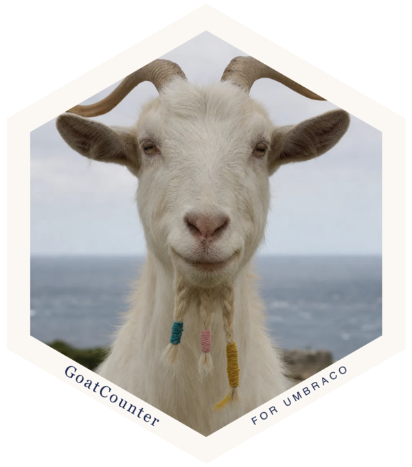
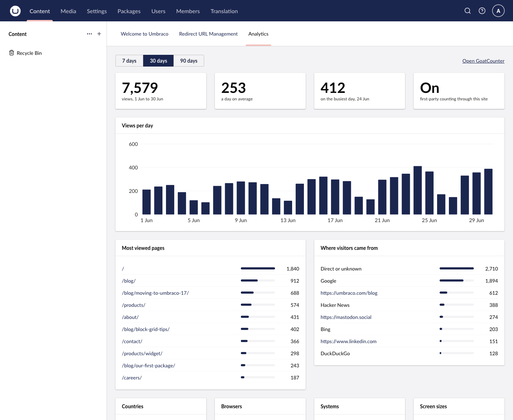
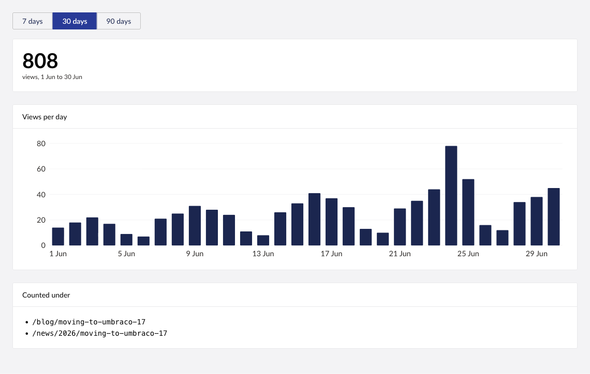
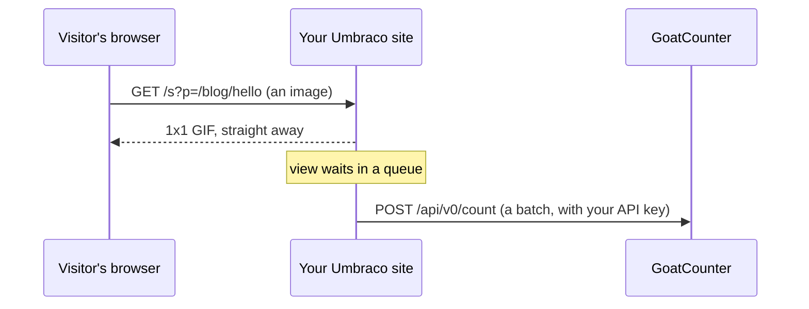
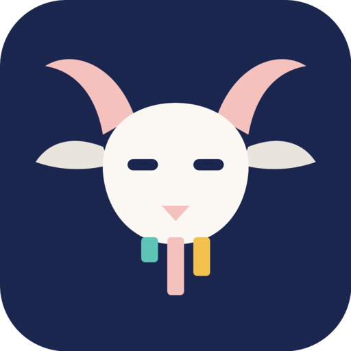

# GoatCounter for Umbraco

[](https://www.nuget.org/packages/Umbraco.Community.GoatCounter/)
[](https://www.nuget.org/packages/Umbraco.Community.GoatCounter)
[](../LICENSE)

[GoatCounter](https://www.goatcounter.com) is a small, open source, privacy-friendly web analytics service. This package brings it into the Umbraco backoffice, and lets your site count its own page views so blockers don't hide your visitors.



*Sample data.*

- **A dashboard** in the Content section: views per day, most viewed pages, referrers, countries, browsers, systems and screen sizes, for the last 7, 30 or 90 days.
- **A Views tab on every page**, showing how often that page was viewed.
- **First-party counting.** Page views go to an endpoint on your own site, which passes them to GoatCounter.

Your API keys stay on the server. The browser never talks to GoatCounter.

Umbraco versions supported: 17.x (tested on 17.0.0 and 17.8.1).

## Installation

```
dotnet add package Umbraco.Community.GoatCounter
```

Installing the package sends nothing. The dashboard appears once `Site` and `Token` are set, and counting starts only when `CountPageViews` is `true`.

## Configuration

```json
"GoatCounter": {
  "Site": "mysite",
  "Token": "an API key that can read statistics",
  "CountToken": "an API key that can record page views",
  "CountPageViews": true,
  "Hostnames": [ "example.com" ]
}
```

| Setting | What it does | Default |
|---|---|---|
| `Site` | Your GoatCounter code (`mysite` for mysite.goatcounter.com), or the full URL of a self-hosted GoatCounter | none |
| `Token` | API key for reading statistics. The dashboard needs it | none |
| `CountToken` | API key for recording page views. Falls back to `Token` | none |
| `CountPageViews` | Turns first-party counting on | `false` |
| `Route` | The path on your site the beacon is sent to | `/s` |
| `Hostnames` | Hosts that are counted. Empty means any host except localhost | empty |
| `CacheMinutes` | How long statistics are kept before GoatCounter is asked again | `5` |

Create API keys in GoatCounter under Settings, API. Keep them out of source control: use user secrets or environment variables (`GoatCounter__Token`).

## Views on every page

Each document gets a Views tab. A page's views are looked up under its URL.



*Sample data.*

If a page used to live somewhere else, register an `IGoatCounterPathProvider` that returns its old paths, and the tab adds them together:

```csharp
public class OldBlogPaths : IGoatCounterPathProvider
{
    public IEnumerable<string> PathsFor(IPublishedContent content)
    {
        if (content.Value<string>("oldPath") is { Length: > 0 } old) yield return old;
    }
}

// in a composer
builder.Services.AddSingleton<IGoatCounterPathProvider, OldBlogPaths>();
```

## Counting page views

Add the beacon to your layout's `<head>`:

```cshtml
@using GoatCounter
@Html.GoatCounterBeacon()
```



- The visitor's browser only ever talks to your site, so blockers that know `gc.zgo.at` and `*.goatcounter.com` have nothing to block.
- Your site answers straight away and sends views on in batches, so a page view never waits on GoatCounter.
- The beacon writes nothing on hosts you don't count, so development and staging sites stay silent.
- Views waiting to be sent are held in memory. A restart loses the last couple of seconds' worth.

GoatCounter uses the visitor's IP address for sessions and location. If your site sits behind a proxy or CDN, configure ASP.NET Core's forwarded headers so the real address is passed on.

## Using the numbers in your own code

Inject `GoatCounterStats` to build things like a "most read" list:

```csharp
var views = await stats.ViewsByPathAsync(days: 7);   // path -> views
```

## Try it in two minutes

The repository has a test site that installs itself.

```
git clone https://github.com/AndyCross/umbraco-goatcounter
cd umbraco-goatcounter/src/GoatCounter.TestSite
GoatCounter__Site=mysite GoatCounter__Token=your-api-key dotnet run
```

Open https://localhost:44355/umbraco, log in with the details in `appsettings.Development.json`, and look for Analytics in the Content section.

## Contributing

Contributions to this package are most welcome! Please read the [Contributing Guidelines](CONTRIBUTING.md).

## Acknowledgements

- [GoatCounter](https://www.goatcounter.com) is made by Martin Tournoij. This package is a client for it and is not affiliated with the project.
- The repository was started from [Lotte Pitcher](https://github.com/LottePitcher)'s [Opinionated Umbraco Package Starter](https://github.com/LottePitcher/opinionated-package-starter).
- Built during a community Umbraco hackathon.

### Logo and sticker

The package icon is a goat with a bar chart for a beard, drawn for this package. The sticker at the top of this page is the same idea as a photograph: it was generated with OpenAI's image model, so no goat sat for it and no beard was braided.


